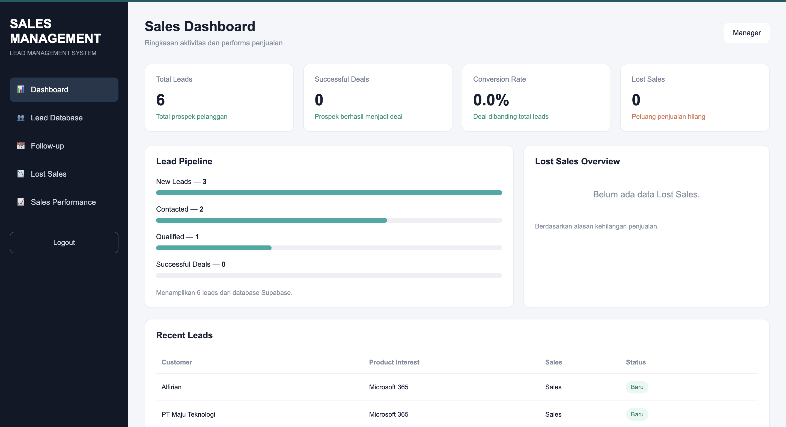

# Sales Management System

A web-based Sales Management System designed to help sales teams manage customer prospects, organize follow-up activities, monitor lost sales opportunities, and track sales performance through a centralized platform.

**Live Demo:** [Sales Management System](https://alfiriansyah.github.io/Sales-lead-management/)

**GitHub Repository:** [Sales-lead-management](https://github.com/alfiriansyah/Sales-lead-management)

---

## Project Overview

Sales Management System is a personal portfolio project focused on digitizing and organizing sales operations through a centralized web application.

The application provides tools for managing customer leads, scheduling follow-up activities, recording lost sales opportunities, and monitoring sales performance.

The project demonstrates how business processes and sales operations can be translated into practical digital solutions using frontend development, database management, and backend integration.

## Key Features

### 1. Sales Dashboard
- Overview of total customer leads.
- Lead pipeline monitoring.
- Deal and conversion indicators.
- Recent customer prospect overview.
- Lost sales summary.

### 2. Lead Management
- Create, view, update, and delete customer prospects.
- Store customer contact information.
- Track product interests and lead sources.
- Update prospect status.
- Search and filter lead records.
- Export lead data to CSV.
- Supabase database integration.

### 3. Follow-up Management
- Create and manage customer follow-up schedules.
- Record customer contact details and product interests.
- Set follow-up priorities and statuses.
- Monitor scheduled, overdue, and completed activities.
- Search and filter follow-up records.
- Export follow-up data to CSV.
- Supabase database integration.

### 4. Lost Sales Management
- Record unsuccessful sales opportunities.
- Categorize reasons for lost sales.
- Track estimated lost revenue.
- Record competitor information and sales notes.
- Create, view, update, and delete lost sales records.
- Export lost sales data to CSV.
- Supabase database integration.

### 5. Sales Performance
- Record sales targets and actual revenue.
- Monitor target achievement percentages.
- Track lead and deal counts.
- Calculate lead conversion indicators.
- Compare sales performance across users.
- Filter performance records by period.
- Export performance data to CSV.
- Supabase database integration.

## Technology Stack

| Technology | Purpose |
|---|---|
| HTML5 | Application structure |
| CSS3 | Styling and responsive layout |
| JavaScript | Application logic and interactions |
| Supabase | Backend services and authentication |
| PostgreSQL | Relational database |
| Supabase Auth | User authentication |
| Row Level Security (RLS) | Database-level access control |
| GitHub Pages | Application hosting |
| GitHub | Version control and source code management |

## System Architecture

The application uses a frontend and backend architecture:

1. **Frontend:** HTML, CSS, and JavaScript provide the user interface and application functionality.
2. **Backend Services:** Supabase provides authentication and database services.
3. **Database:** PostgreSQL stores user profiles, leads, follow-up activities, lost sales records, and sales performance data.
4. **Security:** Supabase Row Level Security (RLS) enforces data access policies based on user roles.
5. **Deployment:** GitHub Pages hosts the web application.

## User Roles & Access Control

The application supports two user roles:

| Role | Access |
|---|---|
| Manager | Can access team-wide sales records and manage team data. |
| Sales | Can access and manage their own assigned sales records. |

Authentication is handled through Supabase Auth.

Database access is controlled using Row Level Security (RLS), ensuring that users can only access records permitted by their assigned roles and database policies.

## Database Structure

The project uses five main database tables:

| Table | Description |
|---|---|
| `profiles` | User profiles and role information. |
| `leads` | Customer prospect records and lead status. |
| `follow_ups` | Customer follow-up schedules and activities. |
| `lost_sales` | Records of unsuccessful sales opportunities. |
| `sales_performance` | Sales targets, actual revenue, lead counts, and deal counts. |

## Project Screenshots

### 1. Dashboard Overview

### 2. Lead Management

### 3. Follow-up Management

### 4. Lost Sales Analysis

### 5. Sales Performance

### 6. Authentication

## Current Development Status

The main application modules have been implemented and connected to Supabase.

Completed implementation:
- Supabase authentication and login/logout functionality.
- Manager and Sales role identification.
- Dashboard integration with database records.
- Lead Management CRUD operations.
- Follow-up Management CRUD operations.
- Lost Sales Management CRUD operations.
- Sales Performance database integration.
- Row Level Security policies for role-based data access.
- CSV export functionality across management modules.

Sales Performance currently uses manually entered target and actual revenue records. Automatic performance calculations directly from lead and deal transactions are not yet implemented.

## Future Improvements

- Automate sales performance calculations using actual lead and deal data.
- Implement lead assignment and reassignment workflows.
- Improve team management and sales activity monitoring.
- Add advanced sales analytics and reporting.
- Enhance data visualization and dashboard insights.
- Improve validation and user experience.

## Learning Objectives

Through this project, I aim to develop practical skills in:

- Translating business requirements into digital solutions.
- Sales operations and customer relationship management.
- Database design and relational data management.
- Authentication and role-based access control.
- Frontend development and JavaScript programming.
- Backend integration using Supabase.
- Applying database security through Row Level Security.
- Deploying web applications using GitHub Pages.

## Author

**Alfi Riansyah**

Business Development | Marketing | Sales Operations | Digital Business Solutions

- GitHub: [@alfiriansyah](https://github.com/alfiriansyah)
- LinkedIn: [Alfi Riansyah](https://www.linkedin.com/in/alfi-riansyah-s-h-b27460235/)

---

*This project is developed as a personal portfolio project to explore the intersection of business operations, sales management, and technology.*
